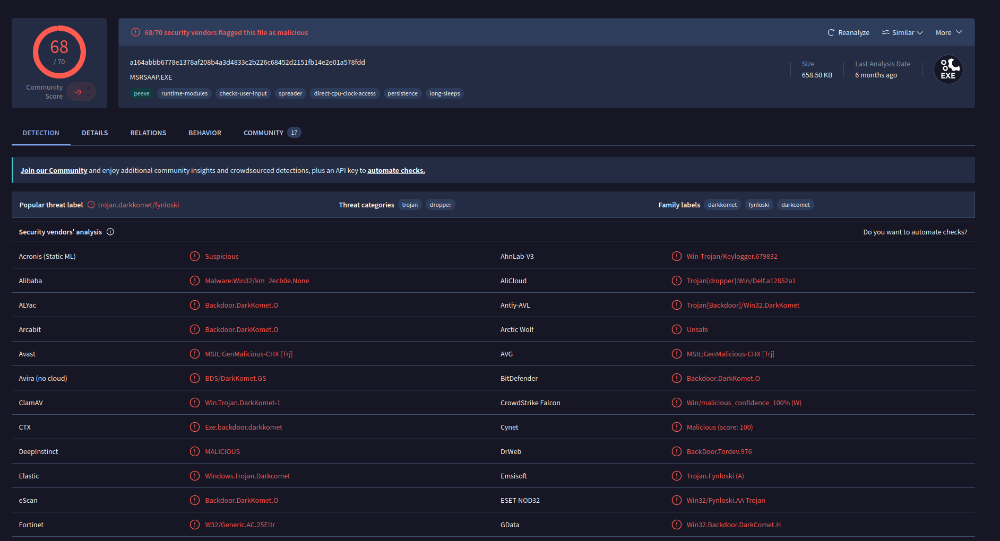
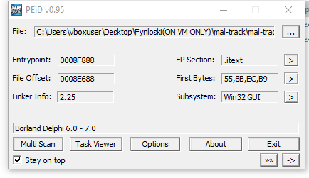

## Malware fingerprinting

### Sample Info

| Field    | Value                                                              |
| -------- | ------------------------------------------------------------------ |
| MD5      | `59bc20336206070fa5312f03f1aee02e`                                 |
| SHA-1    | `99dc38244141f56a60975899dd888eff0f5002b3`                         |
| SHA-256  | `a164abbb6778e1378af208b4a3d4833c2b226c68452d2151fb14e2e01a578fdd` |
| Analysis | Static                                                             |
| OS       | Windows                                                            |
| Format   | PE                                                                 |
| Arch     | i386                                                               |
| Path     | `C:/Users/vboxuser/Desktop/mal-track.exe`                          |

**MAEC malware category:** launcher

### Hash Lookup

## Static Analysis

### FLOSS

see [floss.txt](./assets/floss.txt)

### Detecting Packers with PEiD (Delphi)

### Decompiling

Using Ghidra to decompile the binary with [Dhrake](https://github.com/huettenhain/dhrake) plugin and after inspecting the decompiled output it seems that this program is a RAT.
See [FUN_004760a4.c](./assets/malware/FUN_004760a4.c) and [partial_FUN_004760a4.go](./assets/malware/partial_FUN_004760a4.go)

- FUN_004760a4 is called by a function that creates a socket at '127.0.0.1:1604'

- The RAT waits for one of those commands to be sent by the server '127.0.0.1:1604':
  see [commands](./assets/commands.txt)

### Behavior and Capability Analysis

see [capa.md](./assets/capa.md)

### Dynamic Analysis

### Processes

| Process                                             | Observation                                                                                                                               |
| --------------------------------------------------- | ----------------------------------------------------------------------------------------------------------------------------------------- |
| `C:\Users\vboxuser\Desktop\mal-track.exe`           | Runs, creates the process below, then exits                                                                                               |
| `C:\Users\vboxuser\Documents\maltrack\maltrack.exe` | Created by `mal-track.exe` (`Process Create`). Still running at end of capture in [mal-track.xml](./assets/process_capture/mal-track.xml) |

### Files

| Path                                                             | Operation observed                                                  | Result         |
| ---------------------------------------------------------------- | ------------------------------------------------------------------- | -------------- |
| `C:\Users\vboxuser\Documents\maltrack\`                          | Directory created by `mal-track.exe`                                | SUCCESS        |
| `C:\Users\vboxuser\Documents\maltrack\maltrack.exe`              | Created with `OverwriteIf`; `SetEndOfFile` = 674,304 bytes          | SUCCESS        |
| `C:\Users\vboxuser\Documents\maltrack\Z6mh6RQnzK2e\maltrack.exe` | Opened (read attributes) by `mal-track.exe` before the drop         | PATH NOT FOUND |
| `C:\Users\vboxuser\AppData\Roaming\dclogs\2026-11-19-5.dc`       | Created by `maltrack.exe`, 37 bytes written (`WriteFile`, offset 0) | SUCCESS        |

### Registry

| Key / value                                                                              | Operation    | Data                                                                                           | Result            |
| ---------------------------------------------------------------------------------------- | ------------ | ---------------------------------------------------------------------------------------------- | ----------------- |
| `HKCU\SOFTWARE\DC3_FEXEC`                                                                | RegCreateKey | `REG_CREATED_NEW_KEY`                                                                          | SUCCESS           |
| `HKCU\SOFTWARE\Microsoft\Windows\CurrentVersion\Run\Mal-Track`                           | RegSetValue  | `REG_SZ`: `C:\Users\vboxuser\Documents\maltrack\maltrack.exe`                                  | SUCCESS           |
| `HKLM\SOFTWARE\Microsoft\Windows NT\CurrentVersion\Winlogon\UserInit`                    | RegSetValue  | `REG_SZ`: `C:\Windows\system32\userinit.exe,C:\Users\vboxuser\Documents\maltrack\maltrack.exe` | **ACCESS DENIED** |
| `HKCU\SOFTWARE\Microsoft\Windows\CurrentVersion\Internet Settings\ZoneMap\ProxyBypass`   | RegSetValue  | `REG_DWORD`: 1                                                                                 | SUCCESS           |
| `HKCU\SOFTWARE\Microsoft\Windows\CurrentVersion\Internet Settings\ZoneMap\IntranetName`  | RegSetValue  | `REG_DWORD`: 1                                                                                 | SUCCESS           |
| `HKCU\SOFTWARE\Microsoft\Windows\CurrentVersion\Internet Settings\ZoneMap\UNCAsIntranet` | RegSetValue  | `REG_DWORD`: 1                                                                                 | SUCCESS           |
| `HKCU\SOFTWARE\Microsoft\Windows\CurrentVersion\Internet Settings\ZoneMap\AutoDetect`    | RegSetValue  | `REG_DWORD`: 0                                                                                 | SUCCESS           |

### Network (from `maltrack.exe`)

| Event                                    | Local endpoint → remote endpoint     | Result  |
| ---------------------------------------- | ------------------------------------ | ------- |
| `TCP Reconnect` (4 events, ~0.5 s apart) | `windows10:49671` → `windows10:1010` | SUCCESS |
| `TCP Disconnect`                         | `windows10:49671` → `windows10:1010` | SUCCESS |
